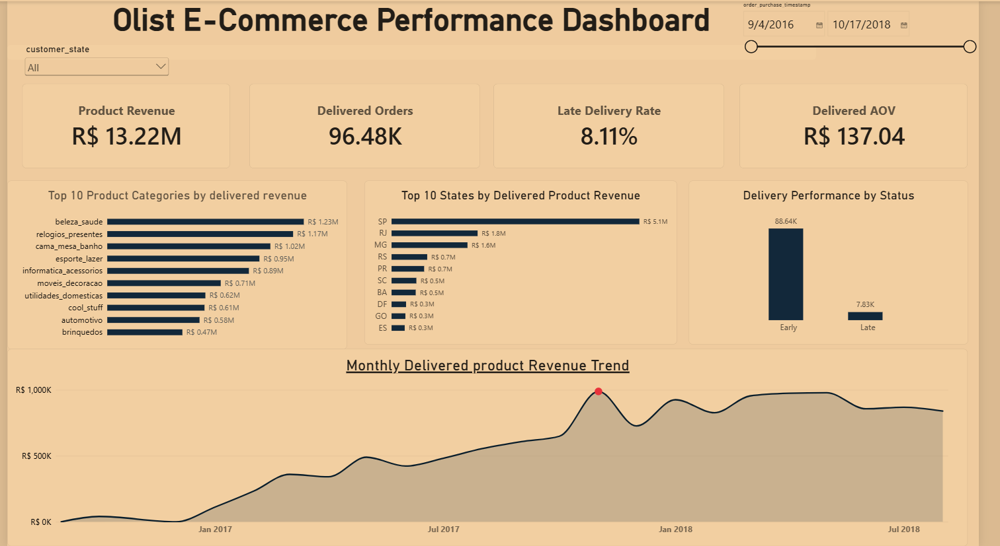
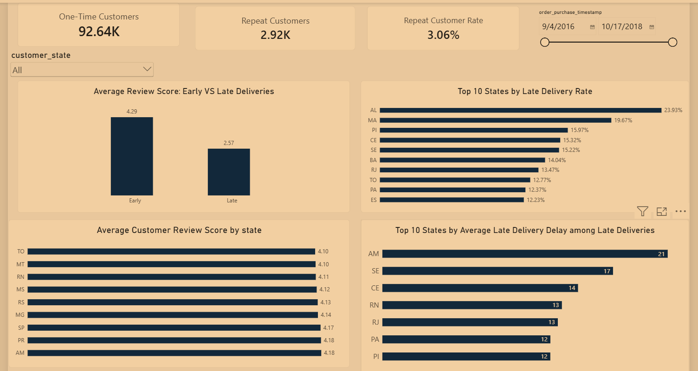

# Olist E-commerce Analysis

## Project Overview

This project explores the Brazilian e-commerce business using the Olist Brazilian E-Commerce Public Dataset.

The main objective is to understand overall business performance, analyse customer behaviour, evaluate product and regional performance, and identify opportunities to improve delivery performance and customer experience.

This is an end-to-end data analytics project using Python, SQL, and Power BI.

## Power BI Dashboard

### 1. Executive Overview



### 2. Customer & Delivery Analysis



## Business Objectives

The analysis focuses on answering five key business questions:

1. How is the business performing in terms of revenue and orders?
2. Which product categories generate the highest revenue?
3. What does customer purchasing behaviour reveal about repeat purchases?
4. Which states and regions contribute the most to business revenue?
5. How does delivery performance relate to customer satisfaction?

## Tools & Technologies

| Tool | Purpose |
|---|---|
| Python | Data inspection, cleaning, and understanding |
| Jupyter Notebook | Exploratory data analysis |
| PostgreSQL | Data validation and SQL analysis |
| SQL | Business queries and KPI analysis |
| Power BI | Dashboard development and visualisation |
| Git & GitHub | Version control and project hosting |

## Project Workflow

### 1. Data Understanding and Cleaning — Python

- Inspected dataset structure and data types.
- Checked missing and null values.
- Examined data quality and consistency.
- Prepared the data for further analysis.

### 2. Data Validation and Analysis — SQL

Used PostgreSQL to validate the database and perform business analysis.

The SQL analysis is organised into five files:

- `01_sales_analysis.sql` — Sales and revenue analysis.
- `02_product_category_analysis.sql` — Product and category performance.
- `03_customer_analysis.sql` — Customer purchasing behaviour.
- `04_regional_analysis.sql` — Regional and state-level performance.
- `05_delivery_analysis.sql` — Delivery performance analysis.

### 3. Dashboard Development — Power BI

Created a two-page dashboard:

- **Executive Overview:** Business performance, revenue, orders, and product and regional insights.
- **Customer & Delivery Analysis:** Customer purchasing behaviour, delivery performance, and customer satisfaction.

## Key Business Insights

The analysis identified the following findings:

| Business Area | Key Finding |
|---|---|
| Revenue | Delivered product revenue was approximately R$13.22 million. |
| Orders | 96,478 delivered orders were analysed. |
| Average Order Value | Delivered-order AOV was approximately R$137.04. |
| Product Category | `beleza_saude` was the highest-revenue category, generating approximately R$1.23 million. |
| Regional Performance | São Paulo (SP) was the leading state by revenue, contributing approximately R$5.1 million. |
| Customer Behaviour | Repeat customer rate was approximately 3.06%. |
| Delivery Performance | Approximately 8.11% of orders were delivered late. |
| Customer Satisfaction | Average review score was 4.29 for early deliveries and 2.57 for late deliveries. |

*Note: Metrics are based on the respective analysis definitions and filters used in the project.*

## Business Recommendations

Based on the findings:

1. **Improve delivery performance:** Investigate regions with higher late-delivery rates and identify operational causes.
2. **Focus on customer experience:** Monitor customer reviews and investigate the relationship between delivery delays and lower satisfaction.
3. **Strengthen customer retention:** Explore strategies to encourage first-time customers to purchase again.
4. **Monitor product performance:** Track category-level revenue to identify opportunities for growth.

These are recommendations for further business investigation, not proof that a particular intervention will improve results.

## Repository Structure

```text
olist-ecommerce-analysis/
│
├── .gitignore
├── README.md
├── database.sql
├── data_cleaning_&_understanding.ipynb
│
├── 01_sales_analysis.sql
├── 02_product_category_analysis.sql
├── 03_customer_analysis.sql
├── 04_regional_analysis.sql
└── 05_delivery_analysis.sql
```

## Dataset

**Dataset:** Olist Brazilian E-Commerce Public Dataset

The dataset contains information about orders, customers, products, payments, sellers, reviews, and deliveries.

The original dataset files are not included in this repository. Download the dataset separately before reproducing the analysis.

## How to Explore This Project

1. Download the Olist dataset.
2. Open the Jupyter Notebook to review data inspection and cleaning.
3. Set up PostgreSQL and load the required dataset tables.
4. Use `database.sql` for database creation and validation.
5. Run the five SQL analysis files to explore the business questions.
6. Open the Power BI dashboard once its file is added to the repository.

## What I Learned

Through this project, I gained practical experience in:

- Understanding and preparing real-world datasets.
- Writing SQL queries to answer business questions.
- Analysing sales, products, customers, regions, and delivery performance.
- Calculating and interpreting business KPIs.
- Building dashboards to communicate findings.
- Translating data analysis into actionable business recommendations.

---

**Project Type:** End-to-End Data Analytics  
**Domain:** E-commerce / Retail  
**Tools:** Python | PostgreSQL | SQL | Power BI | GitHub